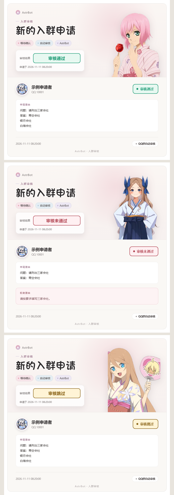

<div align="center">
  <h1>AstrBot QQ群自动审核插件</h1>
  <p>基于 AstrBot + OneBot V11 的智能 QQ 群自动审核插件</p>
  <p>
    <a href="README_CN.md">简体中文</a> · <a href="README_EN.md">English</a>
  </p>
  <p>
    
    
    
    
  </p>
</div>

## 项目介绍

AstrBot QQ群自动审核插件是一款面向 QQ 群管理场景的智能审核插件。

插件基于 OneBot V11 协议监听群申请事件，并结合规则系统、AI
审核以及 Agent 智能工具调用，实现自动化群管理。

## 核心功能

### 1. 自动入群审核

支持：

-   自动同意入群申请
-   自动拒绝入群申请
-   根据审核规则自动判断
-   支持管理员配置审核策略

### 2. AI 自动审核验证答案

插件支持使用 AI 分析用户填写的入群验证内容。

技术点

* 获得群昵称
* 获得群公告历史第一条和最新一条
* AI 根据群昵称, 群公告, 问题和回答的答案综合考虑是否同意申请

例如：

用户申请：

    问题：为什么加入本群？
    回答：喜欢学习计算机技术

AI 可以根据群规则判断是否符合要求。

支持：

-   自然语言理解
-   验证答案分析
-   智能审核建议

### 3. 审核记录

插件会保存每个群的入群申请审核记录，包括申请者昵称、QQ、申请理由、审核状态、拒绝理由和时间。

-   使用 `/验证 记录` 查看第 1 页
-   使用 `/验证 记录 <页码>` 查看指定页
-   每页最多显示 5 条记录
-   达到记录上限后自动删除最早的记录
-   普通群成员也可以查看本群记录
-   也可以发送 `/群管助手 查看审核记录` 查询

记录上限可以在插件配置中修改，默认每个群保存 5 条；设置为 0 时不保存新记录。

### 4. 图片审核通知

检测到入群申请后，插件会将申请信息渲染为图片发送到群内。

图片包含：

-   申请者真实 QQ 头像
-   申请者昵称和 QQ
-   申请理由
-   申请时间
-   审核状态
-   未通过时的拒绝理由

审核状态使用不同颜色展示：通过为绿色、未通过为红色、跳过为黄色。

如果图片渲染服务暂时不可用，插件会自动回退为文字消息。



### 5. 插件配置界面

提供插件配置功能：

支持：

-   设置默认最低等级
-   设置默认是否开启等级限制
-   AI 审核失败后的动作 --> Skip/Reject
-   自定义拒绝理由长度

### 6. Agent 智能管理

群主和管理员可以在群内发送 `/群管助手 <操作>`，让 Agent 调用工具管理本群。也可以 @ 机器人后输入 `群管助手 <操作>`。

    /群管助手 关闭本群的自动审核
    /群管助手 关闭群画像公告自动更新
    /群管助手 开启群画像公告自动更新
    /群管助手 我要上传群画像
    /群管助手 把 QQ 123456789 加入白名单
    /群管助手 查看白名单有哪些用户

普通群员可用 `/验证 记录` 或 `/群管助手 查看审核记录` 查询本群记录。

群主和管理员可发 `上传群画像`、`/上传群画像` 或通过 Agent 发起上传。机器人提示等待后，由发起人在 5 分钟内把审核标准以纯文本发到同一个群，支持换行。

群画像也支持直接在群里说「给我看看本群的群画像」「帮我换一下本群的审核标准」或「把群画像的公告自动更新关掉」。也可以 @ 机器人后说同样的话。

## 配置

支持多群独立配置：

``` json
{
    "groups": {
        "群号": {
            "REQUEST_CONFIG": true,
            "LEVEL_REQUIRED_CONFIG": true,
            "MIN_LEVEL": 5,
            "BLACKLIST": [],
            "WHITELIST": []
        }
    }
}
```

## 项目结构

    astrbot_plugin_group_auto_approve
    
    ├── main.py
    ├── metadata.yaml
    ├── README.md
    ├── logo.png
    ├── review_example.png
    └── web/

## 安装

进入 AstrBot 插件目录：

``` bash
git clone https://github.com/maruyui-dev/astrbot_plugin_group_auto_approve.git
```

重启 AstrBot 即可。

## 环境要求

-   AstrBot
-   OneBot V11

推荐：

-   NapCat
-   LLOneBot

## License

MIT License

## Supports

- [AstrBot Repo](https://github.com/AstrBotDevs/AstrBot)
- [AstrBot Plugin Development Docs (Chinese)](https://docs.astrbot.app/dev/star/plugin-new.html)
- [AstrBot Plugin Development Docs (English)](https://docs.astrbot.app/en/dev/star/plugin-new.html)
